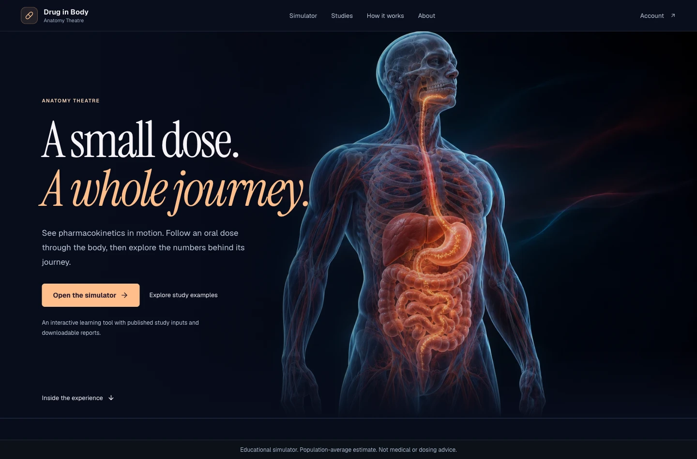
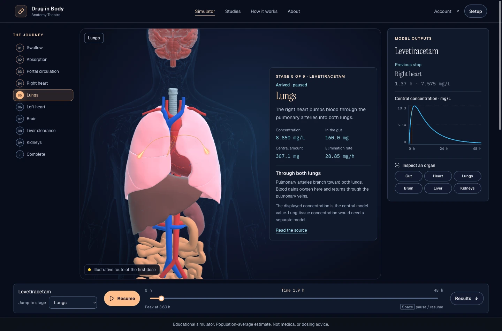

# Anatomy Theatre · Drug-in-Body Simulator

An interactive web simulator for learning oral pharmacokinetics. Follow a dose through a 3D anatomy model, then see how the simulated concentration changes over time and where the input values came from.



## Run locally

Use Node.js 24 and npm.

```sh
git clone https://github.com/TatvagnaTandel/Drug-Ingestion-Simulation.git
cd Drug-Ingestion-Simulation
npm ci
npm run dev:web
```

Open [localhost:3000](http://localhost:3000) and choose **Open the simulator**. Select **Levetiracetam** or **Linezolid** and click **Start journey**. Both studies work without an account or API keys. To try a custom schedule without Supabase, choose **Custom setup → Load synthetic example → Run and play**.

## Follow a dose

The camera follows the first scheduled oral dose from swallowing and absorption through circulation, distribution and clearance. It pauses at organ stops while the explanation and model values update. Use the journey rail to jump to a stage, scrub the timeline, or press **Space** to pause or resume when focus is outside a form control. The organ monitor lets you inspect individual organs.



## Read and export results

Open **Results** to see the concentration curve, peak concentration, time to peak and when the curve stays below 5% of its peak after the last dose. With multiple medicines, each medicine has its own curve. **Download PDF** exports the dose schedule, model inputs, figures, journey checkpoints and source references. The built-in studies cite published adult research and prescribing information.


## Explore the heart at every scale

[`/heart`](apps/web/app/heart) is a second view built on the same theatre shell. It draws a procedural heart with separately named chambers, valves, great vessels, coronaries, conduction fibres and blood cells, and it zooms from the whole organ down to the muscle and capillary scale as you scroll or pinch. Drag to orbit, wheel or pinch to zoom, click a structure to read about it, double-click to fly the camera there.

The layer panel fades the pericardium, muscle, valves, arteries, veins, coronaries, conduction system and blood independently. The cutaway slider clips the model with a movable plane, the exploded slider pulls the layers apart, and X-ray mode ghosts the surfaces so the internal structures stay visible.

The beat follows the phases recorded in [`physiology.json`](apps/web/data/heart/physiology.json) — atrial systole, isovolumetric contraction, ejection, isovolumetric relaxation, filling — so the ECG strip, pressures, volumes, valve states and cardiac output all come from one curve. Presets set resting, exercising and sleeping rates, and the phase buttons step through the cycle one phase at a time.

The **Substance** picker sends particles along the oral route: gut → portal vein → liver → vena cava → right heart → lungs → left heart → aorta → body. Each substance lists the direction of its modelled effects only; no amounts appear anywhere. Twelve teaching conditions (normal, coronary plaque, ischaemia, AFib, tachycardia, bradycardia, heart block, stenosis, regurgitation, heart failure, hypertrophy, septal defect) reshape the same model, and a short quiz tests recall.

To extend it, edit the JSON in [`apps/web/data/heart`](apps/web/data/heart). A new entry in `anatomy.json` appears in the jump list and the info card as long as its `mesh` matches a registered mesh name. Geometry lives in [`components/heart/geometry.ts`](apps/web/components/heart/geometry.ts); camera, cardiac cycle, materials and audio live in [`components/heart/engine.ts`](apps/web/components/heart/engine.ts). The heart is procedural, so no Draco or KTX2 tooling is needed to rebuild it.

## Optional Supabase setup

Supabase enables catalogue search, email sign-in and saving eligible custom reports to an account. To use your own project, apply the SQL files in [supabase/migrations](supabase/migrations) in order and follow the [catalogue import and review instructions](scripts/data/README.md). Add the following placeholders to `apps/web/.env.local`, replace them with your project's values and restart the app.

```dotenv
NEXT_PUBLIC_SUPABASE_URL=https://your-project.supabase.co
NEXT_PUBLIC_SUPABASE_ANON_KEY=your-publishable-or-legacy-anon-key
```

Enable email authentication and allowlist `http://localhost:3000/signin` in Supabase Authentication → URL Configuration. For a deployed app, also allowlist its exact sign-in URL. Keep `apps/web/.env.local` and any root `.env` files local. The browser configuration takes a publishable or legacy anon key.

## Model and limits

The oral model uses one central compartment, first-order absorption and elimination, and an optional absorption lag. The walkthrough illustrates anatomy alongside model-wide estimates. Each medicine is simulated independently. Organ tissue concentrations, drug interactions and disease effects are outside the model. Use the simulator for education only.

The heart view is a teaching model, not a diagnostic one: its rates, pressures, volumes and ejection fractions are population averages, and its conditions are stylised illustrations rather than patient-specific predictions.

The local PK reference check currently flags the ibuprofen example. Its simulated time to peak is 1.25 hours against a published reference of 0.79 hours, outside the check's 25% tolerance. The references used for this check are recorded in [data/validation.json](data/validation.json).

## Project map

| Path | What it contains |
| --- | --- |
| [apps/web](apps/web) | Next.js interface, Three.js anatomy and browser PDF export |
| [apps/web/components/heart](apps/web/components/heart) | Heart simulator scene, geometry, cardiac-cycle engine and page |
| [apps/web/data/heart](apps/web/data/heart) | Heart anatomy, physiology, circulation, substance and quiz data |
| [packages/engine](packages/engine) | Simulation, concentration curves and report metrics |
| [packages/data-client](packages/data-client) | Supabase catalogue, authentication and reports |
| [data](data) and [supabase](supabase) | Reviewed data, validation references and database migrations |
| [docs/PRD.md](docs/PRD.md) and [docs/TRD.md](docs/TRD.md) | Product and technical specifications |

```sh
npm test
npm run typecheck
npm run lint:copy
npm run build:web
```

The anatomy meshes come from BodyParts3D, © The Database Center for Life Science. See the [anatomy attribution and licences](assets/anatomy/README.md#licence) and [CREDITS.md](CREDITS.md).
